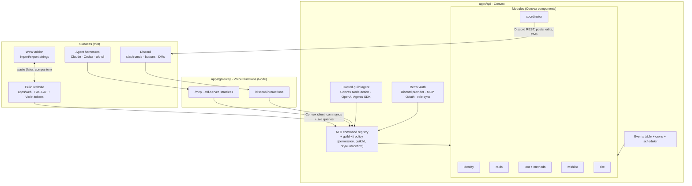
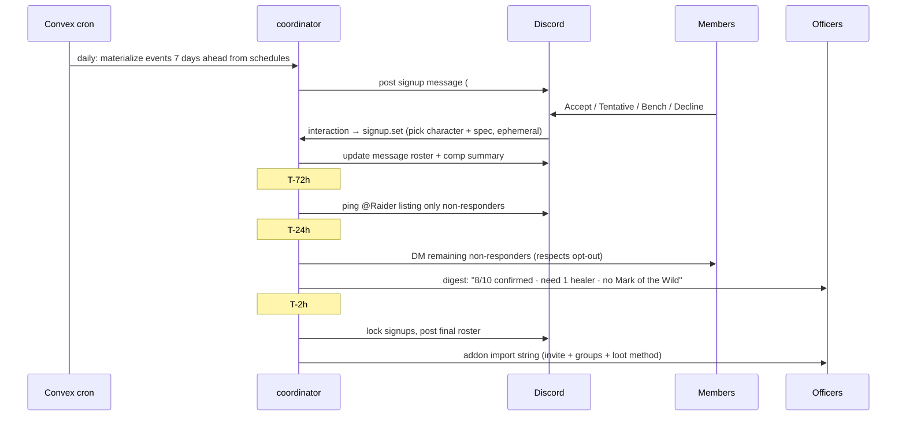

# Vintage — Guild Platform Plan

> Status: **draft v2, ready to build** · Created 2026-10-25 · Owner: Bloodfen · Stakeholder: Stridulent (GM)
>
> A guild platform for **Vintage** on WoW: Forever: an autonomous raid coordinator, guild website, loot system, and in-game addon — all on one typed command surface that people, Discord, and AI agents share.

---

## 1. Vision

Vintage runs its raids out of Discord, spreadsheets, and memory. This project replaces that with one system that:

- **Coordinates raids on its own.** Posts signups, reminds people, flags comp gaps, locks the roster, and hands the raid leader a one-click invite list.
- **Is the guild website.** Public pages for recruitment and progress; a member area for profiles, signups, wishlists, and loot; an officer area for configuration.
- **Uses Discord as identity.** Everyone signs in with Discord. Discord roles *are* the guild ranks — nothing is managed twice.
- **Bridges into the game.** An addon forms the raid, records attendance and loot, and shows loot priority when items drop.
- **Is agent-native.** Every capability is an [AFD](https://github.com/lushly-dev/afd) command reachable over MCP and CLI, so officers and contributors can manage the guild through agent harnesses (Claude, Codex, a hosted guild agent) with the same permissions they have on the website.
- **Grows by modules.** Guild members can contribute features without turning the codebase into a monolith.

Prior art exists (CoGM for guild management, Forever Loot Manager for in-game master-loot auctions, RCLootCouncil, ThatsMyBIS). None of them share one command surface across website, Discord, addon, and agents, and none run the raid calendar for you. That is the gap Vintage fills.

### Principles

1. **Commands are the product (AFD).** One typed command definition drives the web UI, Discord, MCP tools, CLI, and the hosted agent. Interfaces are thin.
2. **Deterministic rules, human-toned delivery.** Code decides schedules, reminders, comp scoring, and loot priority. The AI drafts friendly copy, answers questions, and calls commands — it never decides who gets loot.
3. **Discord is the source of truth for people and ranks.**
4. **Modules own their data.** No module reads another module's tables; they talk through commands and events.
5. **Pure logic lives in libs.** Most behavior is testable without Convex, Discord, or WoW.
6. **Swappable policies.** Loot methods and coordinator rules are configuration, chosen per raid — not baked in.
7. **Web standards first.** FAST-AF web components themed by Violet tokens; no heavyweight app framework.
8. **Improve the foundations.** AFD, botcore, Mechanic, FenCore, FenUI, Violet, and FAST-AF are Bloodfen's projects. Gaps get fixed upstream, not patched here (§7.5).

### Non-goals (for now)

- Replacing Warcraft Logs, boss mods, or WeakAuras.
- Live in-combat data streaming from the game (the addon syncs on reload/logout, or via copy/paste).
- Multi-guild SaaS. Every record carries a `guildId` so this stays possible, but it isn't a goal.
- Publishing our packages to npm. Everything is `workspace:*` in-repo; the CLI runs from the repo.

---

## 2. Key dates

| Date | Event | Implication |
|---|---|---|
| 2026-10-27 → 11-03 | Forever early name reservation | Lock in "Vintage" |
| **2026-11-04** | WoW: Forever launches (3 pm PST) | Foundation live; coordinator testable on dungeon/attunement runs; addon API spike against the live client |
| **2026-12-09** | Barrow Deeps, Hyjal Summit, Onyxia's Lair unlock | Coordinator + addon + loot must be raid-ready. **This is the real deadline.** |

Sources: [Icy Veins roadmap](https://www.icy-veins.com/wow-forever/roadmap), [wowforever.co](https://wowforever.co/release-date/).

---

## 3. Architecture

### 3.1 System overview



Three runtimes, each for a reason:

- **Convex** holds data, commands, crons, and the agent. The website talks to it directly (commands are Convex functions; live queries power the roster board).
- **Vercel functions** host the two endpoints that need a public HTTP surface: `/mcp` (`afd-server`'s stateless handler on the v2 SDK) and `/discord/interactions` (Ed25519 signature check, 3-second ack). Both call Convex. If Convex HTTP actions prove sufficient for both, the gateway can be folded into `apps/api` later.
- **Vercel static hosting** serves the website.

### 3.2 Stack

| Concern | Choice | Notes |
|---|---|---|
| Command framework | `@lushly-dev/afd-core`, `afd-server`, `afd-client`, `afd-cli`, `afd-testing`, `afd-adapters` **2.2** | Zod schemas drive validation, docs, CLI flags, Discord options. 2.2 adds the stateless Streamable HTTP handler and client transport (in progress in a separate AFD session) |
| MCP | `afd-server`'s stateless handler on `@modelcontextprotocol/server` **2.3** (2026-07-28 spec, per-request `createMcpHandler`) | See §3.7 |
| Data + backend | **Convex** (Starter plan to begin) | Realtime queries, TypeScript end to end, crons + scheduled functions, components for module isolation |
| Auth | **Better Auth 1.8** via `@convex-dev/better-auth`, Discord provider only, `@better-auth/mcp` plugin as the OAuth server for MCP clients | Roles synced from Discord; non-members see public pages only |
| Hosting | **Vercel** for the website + gateway | Hobby plan cannot deploy a private GitHub-org repo: one Pro seat or a public repo (Q10) |
| Discord bot | **HTTP interactions endpoint** (serverless) + REST calls from Convex actions | No always-on gateway process for MVP |
| Intelligence | **OpenAI Agents SDK** in Convex Node actions; tools come from the registry | `gpt-5.6-luna` for `/ask` and copy; `gpt-5.6-sol` for comp/strategy reasoning (§3.10) |
| Web UI | **FAST-AF** (FAST Element v3 + AFD) with `violet-elements` primitives and its Router, Vite | `afd-adapters` renders `CommandResult`s; themed by Vintage tokens (§3.8, §3.9) |
| Design system | **AFD site** design language + **Violet** token engine (`afd-site → vintage → dark/parchment`) | Build-time export to CSS, TS, and a FenUI Lua theme; plain-DTCG fallback |
| Addon | **`Vintage`** on **FenCore, FenUI, MechanicLib**, LibSerialize + LibDeflate, Ace3 as needed | Weekly addon layout (§3.6); Forever uses the Mainline API family, so these Retail libraries carry over; published on CurseForge |
| Repo tooling | **botcore** (`lushly-botcore`) + `botcore-vintage` plugin | Same commands locally, in CI, and for contributors' agents |
| Monorepo | **pnpm workspaces + Turborepo** | `--affected` CI, remote cache |

### 3.3 Command surface

Every capability is an AFD command. A command definition carries:

- name (`raid.create`, `signup.set`, `loot.award`, …)
- input/output Zod schemas
- required permission tier (derived from Discord roles, §3.4)
- `mutates`, `dryRun` support, and a confirmation requirement for destructive commands
- a human-readable result summary and an agent-facing description

**Where commands run.** Each module defines its commands in `src/commands/`. `apps/api` registers them as Convex functions through `packages/guild-kit`, which resolves the caller (web session, MCP token, Discord interaction, or the hosted agent acting for a member), checks permission, injects `guildId`, and enforces `dryRun`/confirm. A command handler calls its own module's Convex component for data. When one module needs another, it calls the other module's command through its `contract` at this layer; components never call each other.

**Same identity everywhere.** An officer's agent over MCP can run `roster.lock`; a trial's agent can only manage its own signups and wishlist. MCP clients authenticate through Better Auth's OAuth flow and act as that user.

**Contract stability.** CI generates `commands.manifest.json` (names, schemas, permissions) and diffs it on every PR. Breaking changes require a `breaking-contract` label.

**MVP command namespaces**

| Namespace | Commands | Module |
|---|---|---|
| `member` | `me`, `list`, `prefs.set` | identity |
| `character` | `add`, `update`, `remove`, `list` | identity |
| `schedule` | `create`, `update`, `list` | raids |
| `raid` | `create`, `reschedule`, `cancel`, `get`, `list`, `export` (addon string) | raids |
| `signup` | `set`, `get`, `list` | raids |
| `roster` | `lock`, `unlock`, `bench`, `move`, `remove` | raids |
| `comp` | `suggest` | raids |
| `coordinator` | `status`, `pause`, `resume`, `run` (manual tick) | coordinator |
| `loot` | `drop.record`, `award`, `history`, `method.configure` | loot |
| `item` | `upsert` (from addon exports), `get`, `search` | loot |
| `wishlist` | `set`, `get`, `list` | wishlist |
| `site` | `page.publish`, `news.post` | site |
| `agent` | `ask`, `pause`, `resume` | agent |

Destructive: `raid.cancel`, `roster.remove`, `loot.award`, `character.remove`, `site.page.publish`.

### 3.4 Identity and Discord roles

- **Sign-in:** Discord OAuth only (scopes: `identify`, `guilds.members.read`).
- **Discord role → guild rank → permission tier** (Q1, answered 2026-10-25 from the Vintage Discord). The role → rank map is officer-editable config keyed by Discord role id; rank → tier is fixed in code (`RANK_TIER` in the identity contract):

  | Discord role | Guild rank | Tier | Can |
  |---|---|---|---|
  | `@Officer` | officer | officer | everything: guild settings, loot policy and awards, roster, schedules, site pages, agent controls |
  | `@Raid Leader` | raid-leader | leader | run the night: roster moves, comp, schedules, coordinator controls; no loot policy or site admin |
  | `@Raider` | raider | raider | sign up, wishlist, standings and loot history; **first dibs** in coordinator priority |
  | `@Flex Raider` | flex-raider | raider | same permissions as Raider; pulled in by availability and comp needs |
  | `@Recruit` | recruit | recruit | sign up, wishlist; under evaluation (~2 weeks) |
  | `@Member` | member | member | profile, characters, member pages; no raiding intent |
  | `@Friend` (Discord only) | friend | public | public pages only; not in the guild |
  | no rank role, or not in the server | — | public | public pages only |

  Rank and tier are separate: rank is guild standing (used for coordinator priority), tier is permission. Being in the Discord server alone grants nothing.

- **Sync:** on every sign-in (member object via `GET /users/@me/guilds/{id}/member`) and on a cron via the bot (`GET /guilds/{id}/members`, which requires the Server Members privileged intent; a bot in under 100 servers can enable it in the developer portal without verification).
- **Characters:** members register mains/alts (name, class, spec, role). Later: Battle.net linking to verify ownership.

### 3.5 Game ↔ web bridge

| Direction | MVP | Later |
|---|---|---|
| Web → game | Import string (LibSerialize + LibDeflate, versioned schema) pasted into the addon: roster, groups, loot method + precomputed candidate lists | Companion app writes a data file into the addon folder (Raider.IO pattern), loaded on `/reload` |
| Game → web | Export string from the addon: attendance snapshot, loot received, item data seen | Companion watches SavedVariables and uploads after logout/reload (Warcraft Logs uploader pattern) |

The string format lives in `libs/bridge-format` (TS encoder/decoder) and `addon/Vintage/Core` (Lua encoder/decoder), with **shared golden fixtures** tested on both sides in CI.

**Item data:** Forever hides new-item info until it's discovered on a server, so the addon captures item data it sees (via `C_Item.GetItemInfo` and tooltips) and uploads it with exports. The item database fills in from play.

### 3.6 The `Vintage` addon

One addon named **Vintage**, distributed on **CurseForge** so guild members install and update it through the CurseForge app. It follows the conventions of the existing Weekly addon (`_dev_/Weekly`), which already declares Forever (`16001`) with FenCore and FenUI embedded:

| Convention (from Weekly) | Applied to Vintage |
|---|---|
| `## Interface: 120100, 16001` in the TOC | Same Retail + Forever interface line; Forever is the target |
| **Core/** = pure Lua (`Actions/`, `Schemas/`), sandbox-testable | Raid builder logic, roster/groups solver, bridge-format codec, loot candidate display logic |
| **Bridge/** = WoW API adapter (`Context.lua` builds inputs, `Executor.lua` routes named actions to Core) | Action names mirror service commands: `raid.import`, `raid.invite`, `raid.arrange`, `loot.capture`, `raid.export` |
| `FenCoreCompat.lua`, `MechanicIntegration.lua` (optional MechanicLib registration) | Same; Mechanic dashboard, tests, perf blocks |
| `Libs/libs.json` (Mechanic library manifest) + `embeds.xml` | Libraries managed by Mechanic, not git subtrees |
| `.pkgmeta` with `package-as`, `ignore`, and CurseForge `externals` | `package-as: Vintage`; dev-only folders ignored |
| `Tools/validate.py` + `Tools/toolchain.json` (Lua 5.1, busted, luacheck) and a `quality.yml` workflow | Same validator, invoked from CI and from the botcore `addon.test` command |
| `Tests/` busted specs, `Locales/`, `Dev/` excluded from the package | Same |

**Forever API facts** (from the [1.60.1 API changes](https://warcraft.wiki.gg/wiki/Patch_1.60.1/API_changes) and Blizzard's developer Q&A):

- Forever (client 1.60.1, internal name Camelot) shares Mainline WoW's UI architecture and the vast majority of 12.1.5 APIs. It is **not** the Classic Era API. That is why Weekly, FenCore, FenUI, and MechanicLib run on it unchanged, and why Mechanic's Retail-generated API stubs should mostly cover it.
- Use the namespaced APIs: `C_Item.GetItemInfo`, `C_Spell.*`, `C_AddOns.GetAddOnMetadata`, `C_PartyInfo.InviteUnit`. Legacy globals like `GetItemInfo` are reported missing.
- Detect Forever with `WOW_PROJECT_ID == WOW_PROJECT_CAMELOT` (18) or the interface range, not by assuming Classic. Optional TOC gating: `## AllowLoadGameType: forever` (put it first).
- Midnight's secret-value restrictions are active (e.g. unit health is a secret value); trial accounts cannot send addon messages. Neither affects MVP, which uses paste strings rather than addon comms, and raid roster/loot APIs rather than unit stats.

Local development: link `addon/Vintage` into `Interface/AddOns/Vintage` so Mechanic and `/reload` work against the monorepo checkout.

Release: version in `Vintage.toc`, `X-Curse-Project-ID` in the TOC, tag `addon-vX.Y.Z` → `BigWigsMods/packager@v2` with `-t addon/Vintage` (its top-level-directory option, so packaging from the monorepo subdirectory is supported) uploads to CurseForge with the `CF_API_TOKEN` secret, optionally Wago.

If the addon grows large, raid and loot features can later split into load-on-demand child addons shipped in the same CurseForge package. Start with one addon.

### 3.7 MCP surface: stateless from day one

**Target.** The **MCP 2026-07-28** spec ("MCP v2", [Cloudflare's summary](https://blog.cloudflare.com/mcp-v2)) makes the protocol stateless: no `initialize` handshake on the request path, no `Mcp-Session-Id`, `Mcp-Method`/`Mcp-Name` headers for routing and rate limiting, deterministic tool lists with `ttlMs`/`cacheScope` hints, and Multi Round-Trip Requests instead of elicitation streams. Sampling, Roots, Logging, and HTTP+SSE are deprecated. Vintage designs for that model, following a stateless MCP gateway pattern Bloodfen has used before.

**Implementation.** AFD 2.2 (in progress in a separate AFD session; this plan assumes it ships before Phase 0 wires `/mcp`) adds a stateless Streamable HTTP handler to `afd-server`, built on the official v2 SDK (`@modelcontextprotocol/server` 2.3, which implements 2026-07-28). It builds a fresh protocol object per request over AFD's shared registry and middleware, keeps nothing between requests, returns `{ fetch }` for web-standard runtimes (Vercel functions included), and takes `authInfo` from the host, so Better Auth's token check runs in front of it. `afd-client` gains the matching `StreamableHttpTransport`, and `afd-cli` connects with `--transport streamable`. The older `/sse` + `/message` path and sessions are not used. Never use the deprecated features.

- `/mcp` is `afd-server`'s stateless handler wrapping the Vintage registry; `guild-kit` supplies the permission policy and `CommandContext`.
- `apps/cli` is `afd-cli` pointed at `/mcp`.
- The hosted agent (§3.10) uses `afd-client`'s in-process Direct transport against the same registry.
- `guild-kit` keeps the transport behind one adapter. If AFD 2.2 slips, `/mcp` runs on the raw v2 SDK with the same registry and swaps back with a one-file change.

**Tool surface (AFD's meta-tools)**

Rather than one MCP tool per command (dozens of schemas loaded into every agent's context), Vintage uses AFD's grouped tool strategy and meta-tools, the same small-surface pattern botcore uses for its own MCP server:

| Tool | Does |
|---|---|
| `afd-discover` / `afd-detail` | Search and describe commands: names, schemas, examples, filtered to the caller's permissions |
| `afd-call` | Run a named command with input, through the same registry and policy as every other surface |
| `afd-batch` / `afd-pipe` | Several commands in one round trip (e.g. lock a roster, then export it) |

"Who am I and what's going on" is `member.me` and `coordinator.status` through `afd-call`. Frequent reads can be promoted to direct tools later through AFD's individual strategy if usage shows it's worth it. Tool lists are deterministically ordered and carry cache hints.

**Confirmation without sessions**

Destructive commands use a two-step flow that works on every client: a `dryRun` call returns a preview plus a short-lived signed `confirmToken`; the real call must present it. Where a client supports Multi Round-Trip Requests (`input_required`), the same confirmation is surfaced that way.

**Auth**

- Better Auth with the `@better-auth/mcp` plugin is the OAuth authorization server; members authenticate through Discord.
- Client registration order per the new spec: pre-registered clients (Claude, Codex, VS Code) → Client ID Metadata Documents (CIMD) → Dynamic Client Registration only as a deprecated fallback.
- Tokens are audience-bound to the canonical `/mcp` URI (RFC 8707 `resource`); the server advertises and returns `iss` (RFC 9207). Verify the plugin supports both in Phase 0; file upstream or wrap if not.
- `afd-call` enforces per-command permission exactly as the website does. Per-user rate limits, generous to start.

### 3.8 Design system: AFD site, reskinned for WoW

Start from the AFD site design system (`lushly-dev/afdsite`) rather than designing from scratch, then push it toward a WoW feel. Three projects split the work:

| Layer | Project | Role |
|---|---|---|
| Design language | **AFD site** (`lushly-dev/afdsite`) | The starting palette, type roles, spacing, motion, and voice |
| Token engine | **Violet** (`lushly-dev/violet`) | Holds the tokens as an inheritance tree and exports them at build time |
| Components | **FAST-AF** (`lushly-dev/fast-af`) | Web components styled only through token CSS variables (§3.9) |

**What we inherit (structure)**

| From the AFD site | Use in Vintage |
|---|---|
| `brief/design-system.json`: DTCG tokens (`$type` / `$value` / `$description`) | Seeds the `afd-site` base node in Violet |
| `site/styles.css`: primitive → semantic CSS custom properties (color, type scale, weights, leading, tracking, spacing) | Mapped onto Violet's `global` → `semantic` → `component` tiers; this file, not the JSON, is the reference where the two disagree |
| `brief/creative-brief.md`, `style-guide.md`, `motion-guidance.md`, `responsive-strategy.md` | Forked into `docs/design/` and rewritten for Vintage; they double as context for the UX reviewer agent |
| Self-hosted fonts, `font-display: swap`, preload the display face only | Keep |
| Motion is information, not decoration; snaps over fades | Keep; it suits a utility-first raid tool |
| Voice rule: diagnose, don't apologize | Keep: "Signups locked. Raid starts in 2h." not "Oops!" |

**What changes (skin)**

- **Palette:** the warm cream canvas becomes parchment; charcoal becomes dark leather/stone for app chrome. Dark is the default for the member app (people use it at night next to the game); parchment for long-form pages (news, strategy). Red/teal accents become Vintage guild colors (Q12).
- **WoW semantic tokens** the AFD system lacks, which the roster and loot UI need everywhere: item quality (poor → legendary), class colors (Blizzard's standard values), role colors (tank, healer, melee, ranged), signup status (accepted, tentative, bench, declined, no response).
- **Typography:** keep the role split (display / contrast serif / utility sans / mono) but move the display face toward a fantasy inscription. Friz Quadrata is licensed, so the web uses an open-licensed alternative; the addon keeps Friz via FenUI.
- **Ornament, sparingly:** frame borders, dividers, and icon treatment that echo WoW panels without turning the site into a theme park.

**Violet as the token engine**

```
afd-site                    base: AFD site palette, type roles, spacing, motion
└─ vintage                  WoW palette + fonts, guild colors, item quality, class, role, status tokens
   ├─ vintage-dark          member app default
   └─ vintage-parchment     long-form pages (news, strategy)
```

- **Build-time export only.** `libs/design-tokens` holds the node definitions in the repo; a build step runs the Violet CLI to export CSS custom properties (one file per theme node) and a TypeScript token map. The site never fetches tokens at runtime. Violet's runtime SDK is not used for MVP.
- **Theme switching** is CSS: exports are scoped under `[data-theme]`, and components only read `var(--…)` tokens.
- **Agents:** Violet's MCP server and inheritance tracer are useful for the UX reviewer agent and for anyone reskinning.
- **Fallback: plain DTCG.** If the Violet CLI can't export from in-repo files in CI (Q14), the same nodes live as plain DTCG JSON with explicit layering and a small script emits the same outputs. Token names and tiers follow Violet's model either way, so switching touches only the build script.

**One token source, three surfaces.** FenUI also uses tiered tokens (primitive → semantic → component). From the `vintage` nodes we generate CSS for the website, TypeScript constants for Discord embed colors, and a Lua theme table that overrides FenUI's semantic tokens in the addon, so guild colors, class colors, item quality, and signup states match on the website, in Discord, and in game. Violet has no Lua exporter today; a small script converts its JSON export until the upstream exporter ships (§7.5).

**Housekeeping found in the source:** the AFD site's `design-system.json` and `styles.css` have drifted (teal `#07bcbf` vs `#008085`; Fraunces/Inter vs Playfair Display/Darker Grotesque). Vintage forks from `styles.css` as shipped; the drift is an upstream fix.

### 3.9 Components: FAST-AF

**FAST-AF** (`lushly-dev/fast-af`) is an independently maintained FAST Element v3 runtime with AFD extensions. Per `main` as of 2026-10-11:

| FAST-AF piece | Status | Use in Vintage |
|---|---|---|
| `packages/element`: FAST Element 3.0.1 runtime + Router | Shipped | Component runtime and the SPA router for `apps/web` |
| **Definition Schema** | Shipped | Components describe their properties, events, slots, CSS properties, and commands at runtime and as a Custom Elements Manifest |
| **`@command`** | Shipped | Component actions are AFD commands returning `CommandResult`, with reactive availability. "Sign up", "bench", and "award" in the page are the same commands MCP, Discord, and the CLI run |
| `packages/violet-elements`: reusable primitives (buttons, fields, overlays/menus, tables/data grids, surfaces) | Scaffolded | The base for Vintage's primitives; missing primitives go upstream, not into Vintage |
| `packages/components`: Fluent UI WC fork | Legacy reference | Accessibility behavior patterns only |
| `plugins/fastbot-fast-af`: repo-local botcore plugin | Scaffolded | Precedent for `botcore-vintage` (§7.1) |

**Layering.** `violet-elements` explicitly excludes product components, domain composites, and app shells, which matches Vintage's split:

- **Primitives** come from `violet-elements`, themed by Vintage tokens.
- **Vintage composites** live in `packages/ui-kit`: roster board, signup card, comp summary, loot candidate list, item tooltip with quality color, class/role badges.
- **Pages and shell** live in `apps/web` and module `ui/` folders.

**Rules for `packages/ui-kit`:** read only token CSS variables; any data-changing action is a `@command` calling the matching server command; every component's schema is exported to the Custom Elements Manifest in CI; a missing primitive is filed upstream (`upstream:fast-af`) and stubbed locally with a link to the issue.

**Packaging gap:** FAST-AF isn't on npm. Vintage consumes it as a git dependency pinned to a commit until the element and violet-elements packages are published (§7.5).

### 3.10 Hosted guild agent

The agent is a member-facing assistant, not an autonomous actor. It runs where the data is and uses the same commands as everyone else.

- **Runtime:** `packages/agent` on the OpenAI Agents SDK, executed in Convex Node actions. No separate service.
- **Tools:** the same AFD meta-tools over `afd-client`'s in-process Direct transport against the registry, bound to the **asking member's** identity, so the agent can never do more than that member could.
- **Entry points:** Discord `/ask` (acknowledge within 3 seconds, then follow up when the answer is ready), chat on the website, and coordinator copywriting (the agent drafts the friendly wording; a deterministic template is the fallback if the call fails or the budget is exhausted).
- **Models:** `gpt-5.6-luna` by default; `gpt-5.6-sol` for comp and strategy questions. Routing follows `docs/operations/model-routing.md`.
- **Guardrails:** mutating commands go through the same `dryRun` → confirm flow (the agent shows the preview and asks); every tool call is logged with the member and prompt; per-member daily and global monthly spend caps; `agent.pause` kill switch for officers.

### 3.11 Core entities

| Module | Entities (key fields) |
|---|---|
| identity | `Guild`; `Member` (discordId, roles, tier, prefs: dmOptOut, defaultCharacterId, timezone); `Character` (memberId, name, class, spec, role, isMain) |
| raids | `Schedule` (recurrence, lead times, reminder offsets, lockOffset, lootMethodId, configVersion); `RaidEvent` (scheduleId?, startsAt, status, lootMethodId, configVersion); `Signup` (eventId, characterId, status, note); `RosterSlot` (eventId, characterId, group, role) |
| coordinator | `CoordinatorAction` (eventId, rule, target, sentAt, discordMessageId) — the audit log behind "why did the bot ping me?" |
| loot | `Item` (itemId, name, quality, slot, source, discovered); `Drop` (eventId, itemId, boss, lootedBy); `Award` (dropId, characterId, methodId, methodVersion, configVersion, reason, awardedBy); `MethodState` (scope, methodId, state) |
| wishlist | `WishlistEntry` (characterId, itemId, rank, note) |
| site | `Page`, `Post` |
| core (`apps/api`) | `Event` (type, payload, emittedAt, processedAt) — the cross-module bus; `AgentRun` (memberId, prompt, toolCalls, cost) |

Every record carries `guildId`.

---

## 4. Repo layout

GitHub: private org **[Vintage-Guild](https://github.com/Vintage-Guild)** (plain `Vintage` is taken), monorepo `vintage`. Whether the repo stays private interacts with Vercel's plan (Q10).

```
vintage/
├─ apps/                    thin shells: mount and compose, minimal logic
│  ├─ api/                  Convex: convex.config.ts composes module components;
│  │                        command registration via guild-kit, Better Auth, crons, events, agent actions
│  ├─ gateway/              Vercel functions: /mcp (afd-server stateless handler) · /discord/interactions · /health
│  ├─ web/                  guild website: public + member + officer areas
│  └─ cli/                  afd-cli configured for /mcp (`vintage …`)
├─ modules/                 features; each owns its data
│  ├─ identity/             members, characters, Discord role → tier sync
│  ├─ raids/                schedules, events, signups, roster, comp suggestions
│  ├─ coordinator/          autonomous loop: post, remind, digest, lock, announce
│  ├─ loot/                 item DB, drops, awards, history; hosts loot methods
│  │  └─ methods/           softres · council · prio · dkp · epgp · roll
│  ├─ wishlist/             per-character wishlists / BiS lists
│  ├─ site/                 officer-editable pages, news, recruitment, progress
│  └─ labs/<name>/          incubator; feature-flagged off in production
├─ libs/                    pure TS, platform-free, extractable
│  ├─ loot-core/            LootMethod contract + shared loot math
│  ├─ comp-solver/          raid composition scoring (roles, buffs, rank priority)
│  ├─ bridge-format/        game↔web string schema + golden fixtures
│  ├─ wow-data/             classes, specs, roles, buffs, raid/boss metadata
│  ├─ design-tokens/        Violet node defs (afd-site → vintage → themes) → CSS / TS / FenUI Lua
│  └─ discord-kit/          signature verification, embeds, components, timestamps
├─ packages/                platform glue (knows Convex / AFD / Vercel / OpenAI / FAST-AF)
│  ├─ guild-kit/            AFD policy: caller resolution, permissions, guildId, Convex binding, dryRun/confirm
│  ├─ agent/                hosted agent wiring (§3.10)
│  ├─ ui-kit/               Vintage composites on FAST-AF + violet-elements (§3.9)
│  ├─ testing/              fixtures, convex-test helpers
│  └─ config/               tsconfig + lint presets
├─ addon/
│  └─ Vintage/              the CurseForge addon (Weekly layout, §3.6)
│     ├─ Vintage.toc  embeds.xml  .pkgmeta  .luacheckrc
│     ├─ Core/              pure Lua: Actions/, Schemas/, bridge-format codec
│     ├─ Bridge/            Context.lua + Executor.lua (WoW API adapter)
│     ├─ UI/                FenUI views: raid builder, import/export, loot popup
│     ├─ Libs/              managed by Mechanic via libs.json
│     ├─ Locales/  Tests/  Tools/  Dev/
│     └─ MechanicIntegration.lua  FenCoreCompat.lua
├─ tooling/
│  └─ botcore/              botcore-vintage plugin: repo commands + skills
├─ scripts/                 ci-selection.mjs, run-final-validation.mjs, hooks/
├─ docs/
│  ├─ architecture.md
│  ├─ features/             proposed/ · active/ · completed/ (+ README index)
│  ├─ design/               creative brief, style guide, motion, responsive (forked from AFD site)
│  └─ operations/           local-validation.md, model-routing.md, runbooks
├─ .claude/                 skills/ (shared as .codex/skills), agents/, rules/, settings.json
├─ .github/                 workflows, area-ownership.json, CODEOWNERS, PR + issue forms
├─ AGENTS.md                routes agents to commands, boundaries, and skills
├─ INIT.md                  quick orientation for an incoming agent session
├─ botcore.toml             gates (file size, coverage, cycles) + skill seeding
├─ lefthook.yml  commitlint.config.mjs  coverage-ratchets.json
└─ PLAN.md                  this file
```

Later additions: `apps/companion/` (SavedVariables uploader).

### 4.1 What goes where

| Folder | Holds | Can depend on | Must not |
|---|---|---|---|
| `libs/` | Pure capability we own | Other `libs/`, Zod, `@lushly-dev/afd-core` (the shared result vocabulary) | Import Convex, Discord, OpenAI, Vercel, FAST-AF, or anything in `packages/`, `modules/`, `apps/` |
| `packages/` | Platform glue | `libs/`, platform SDKs | Import `modules/` or `apps/` |
| `modules/` | Features + their data | `libs/`, `packages/`, other modules' **`contract` only** | Read another module's tables or internals |
| `apps/` | Composition + transport | Anything below | Contain feature logic |
| `addon/Vintage/Libs/` | Upstream WoW libraries (FenCore, FenUI, Ace3, LibDeflate…) | — | Be edited in place (fix upstream, re-sync via Mechanic) |
| `addon/` | The Lua addon | Its `Libs/` | Re-implement loot methods in Lua (consume precomputed data); call WoW APIs outside `Bridge/` |

### 4.2 Module anatomy

```
modules/raids/
├─ module.json        name, owners, maturity (core | official | labs), dependsOn
├─ src/domain/        pure logic (or thin calls into libs/)
├─ src/commands/      AFD command definitions
├─ src/contract.ts    public surface: command types + emitted events
├─ convex/            Convex component: this module's tables + internal functions
├─ ui/                FAST-AF panels mounted by apps/web
├─ tests/
└─ AGENTS.md          module-specific conventions
```

`package.json` `exports` exposes only `./contract`, `./commands`, `./convex`, `./ui`. Deep imports fail at resolve time.

### 4.3 Boundary rules (enforced in CI)

1. **Dependencies point down:** `apps → modules → packages → libs`. No upward imports, no cycles.
2. **Modules interact via contracts:** call another module's commands, or subscribe to its events. Never import its internals or read its tables.
3. **Convex components isolate data.** Each module's tables live in its component. Components don't see auth; `apps/api` authenticates and authorizes, then calls components with an explicit member/guild context. *Fallback if local components prove awkward (Q8):* namespaced folders under `apps/api/convex/modules/` plus lint enforcement.
4. **Events for cross-module reactions.** `raids` emits `raid.completed`; `loot` and `wishlist` subscribe. `apps/api` owns the `Event` table and the scheduler fan-out.
5. **`guildId` on every record** from day one.
6. **pnpm strict mode:** no phantom dependencies.

Enforcement: `package.json` `exports`, dependency-cruiser rules, pnpm strict, and the `repo.check` botcore command.

---

## 5. Loot method contract

Loot is a module with **pluggable methods**, because the guild hasn't settled on a system and different raids may use different ones.

**Game mechanics.** Forever keeps **master loot**: `GiveMasterLoot` is documented for Forever 1.60.1, and three Forever addons (Forever Loot Manager, SimpleLootCouncil, WLC) are built on the raid leader as master looter. Confirm the handout flow on the live client at launch (Q6, low risk). The addon's hooks are `LOOT_OPENED` + `GetNumLootItems` for drops, `GetMasterLootCandidate` + `GiveMasterLoot(slot, candidate)` for the handout, `CHAT_MSG_LOOT` for the record, and `GetLootMethod`/`SetLootMethod` for the mode. If a raid runs group loot instead, the addon still records drops and the award is settled by trade.

### 5.1 Split of responsibility

- **`modules/loot` (host):** item database, drops, awards ledger, trade tracking, history, officer UI shell, method configuration per schedule/event.
- **Methods (`libs/loot-core` + `modules/loot/methods/`):** eligibility, candidate ranking, award validation, and their own standings. Pure code.

### 5.2 Interface (`libs/loot-core`)

```ts
export interface LootMethod<Config, State> {
  /** Stable id recorded on every award. */
  id: string                                   // 'softres' | 'council' | 'prio' | 'dkp' | 'epgp' | 'roll' | …
  version: number
  /** Drives validation, the officer config UI, and afd-detail. */
  configSchema: ZodType<Config>
  initialState(config: Config): State

  /** Who should get this item, best first, with a human-readable reason per candidate. */
  candidates(item: Item, ctx: MethodContext<Config, State>): RankedCandidate[]

  /** Reject awards the method doesn't allow (e.g. softres: must have reserved). */
  validateAward(award: AwardDraft, ctx: MethodContext<Config, State>): ValidationResult

  /** Pure state transition: DKP spend, EPGP GP, prio list pop, reserve consumed… */
  apply(award: Award, ctx: MethodContext<Config, State>): State

  /** Optional member-facing standings (DKP table, prio lists, EP/GP). */
  standings?(ctx: MethodContext<Config, State>): Standing[]

  /** Optional maintenance after a raid (decay, attendance EP). */
  onRaidCompleted?(raid: CompletedRaid, ctx: MethodContext<Config, State>): State
}

export interface MethodContext<Config, State> {
  config: Config
  state: State
  raid: RaidContext        // attendees, tiers, wishlists, recent awards
}
```

### 5.3 Rules

- **Methods are pure.** No I/O; the host loads context and persists state. Every method is unit-testable with fixtures and safe for a guildie to contribute.
- **Chosen per raid.** Schedules and events carry `{ lootMethodId, configVersion }`. Onyxia can run soft-reserve while Hyjal runs council.
- **Every award records** `methodId`, `methodVersion`, and `configVersion`, so history stays valid when the guild switches systems.
- **The addon is method-agnostic.** The raid import string carries the method id and precomputed candidate lists per expected item; the popup shows "Prio: Aeryn › Kol (wishlist #1)" without Lua implementations of each method.
- **Officers always decide.** Candidates are recommendations; `loot.award` is an officer command with `dryRun` and confirmation.

### 5.4 Candidate methods

| Method | MVP? | Notes |
|---|---|---|
| Soft-reserve | likely | Simple; good for early/pug-friendly raids like Onyxia |
| Loot council | likely | Uses wishlist, attendance, tier, recent loot as inputs |
| Prio lists (TMB-style) | later | Officer-curated per-item priority |
| DKP / EPGP | later | Needs attendance + decay; stateful |
| Open roll / MS>OS | later | Trivial baseline |

---

## 6. Autonomous raid coordinator

The GM's MVP requirement: the bot posts new raid signups and reminds people, acting as the raid coordinator.

### 6.1 Loop



### 6.2 Design rules

- **Timings and rules are config**, per schedule: post lead time, reminder offsets, lock time, which roles are pinged, DM policy.
- **Deterministic triggers; AI only for wording.** The agent drafts friendly copy and targeted nudges ("we're short a resto shaman — your alt Kol is one"), within rate limits (e.g. max N DMs per member per week). A plain template is the fallback.
- **Member preferences:** DM opt-out, default character/spec, timezone, standing availability.
- **Officer overrides** via any surface: `raid.reschedule`, `raid.cancel`, `signup.set --for`, `roster.bench`, `coordinator.pause`.
- **Serverless Discord.** Button and slash-command interactions hit `/discord/interactions`, which verifies `X-Signature-Ed25519` + `X-Signature-Timestamp` against the raw body (401 on failure; Discord probes this with bad signatures and removes the URL if it fails), answers `PING` with `PONG`, and acknowledges within Discord's 3-second limit with a deferred response (type 5, or type 6 for button updates). A Convex action then does the work and edits the message through the interaction token, which stays valid for 15 minutes. Scheduled posts, edits, and DMs are REST calls from Convex scheduled functions.
- **Times are universal.** Every posted time uses Discord timestamp markup (`<t:…:F>`) so each member sees their local time; the website uses the member's timezone preference.
- **Idempotent and observable:** every coordinator action is logged (`CoordinatorAction`) with the triggering rule, so "why did the bot ping me?" has an answer and `/ask` can explain it. Failures post to an officer-only `#vintage-ops` channel.

---

## 7. Repo tooling, CI, and contributions

### 7.1 botcore from day one

A `botcore-vintage` plugin in `tooling/botcore/` provides repo commands, also available to agents over MCP (the FAST-AF repo's Fastbot plugin is the precedent):

| Command | Does |
|---|---|
| `module.new <name>` | Scaffold a module (manifest, contract, component, passing test, AGENTS.md, area-ownership entry) |
| `repo.check` | Boundary rules, cycles, deep imports, command manifest diff |
| `contract.diff` | Show MCP/CLI schema changes vs `main` |
| `addon.libs` | Sync addon libraries from `Libs/libs.json` via Mechanic |
| `addon.test` / `addon.package` | Run `addon/Vintage/Tools/validate.py` (luacheck, busted, TOC/manifest/locale checks); package via Mechanic release commands / BigWigs packager |
| `upstream.file <project>` | Draft an upstream issue (repro, versions, Vintage context) for a human to review before filing (§7.5) |
| `preview.status` | Vercel + Convex preview URLs for the current branch |

CI calls the same botcore commands, so local and CI results match. Contributors need `uv` alongside pnpm.

### 7.2 CI (GitHub Actions)

Modeled on Lushly's `ci.yml` (closest stack match: pnpm + turbo + Vercel + AFD + botcore), with its single-verdict `ci-ok` pattern.

**Shape:** `select` job → conditional lanes → one required check.

1. **`select`** runs `scripts/ci-selection.mjs` against the diff, decides which lanes are owed, and uploads that decision as an artifact.
2. **Lanes** run only when selected:

   | Lane | Selected when | Runs |
   |---|---|---|
   | TS | `apps/ modules/ packages/ libs/` change | `pnpm check:affected` → `turbo run lint type-check test build --affected` (turbo cache + `setup-node` pnpm cache). Libs have no platform deps, so their tests run without Convex or Discord |
   | Contract | any command/schema change | `repo.check` + `contract.diff`; breaking change needs the `breaking-contract` label |
   | Addon | `addon/**` or `libs/bridge-format/**` | `Tools/validate.py --lua lua5.1` (Weekly's `quality.yml` pattern), including the Lua side of the bridge golden fixtures |
   | Workflow contracts | `.github/**` `scripts/**` | Checks that the selection rules and gates still match the repo |

3. **`ci-ok`** runs with `if: always()`, depends on every lane, and is the **only required check**. A lane that was owed but skipped or cancelled fails it: a skipped obligation never counts as green.

**Other workflows**

- `full-validation.yml` (reusable): everything, regardless of diff. Runs when a PR gets the `ci:full-validation` label, on demand, and weekly.
- `release-addon.yml`: on an `addon-v*` tag, `BigWigsMods/packager@v2` with `-t addon/Vintage` builds the addon and uploads to CurseForge (`CF_API_TOKEN` secret).
- `dependency-audit.yml` (daily) and Dependabot with `dependabot-auto-merge.yml` for safe updates.
- `convex-preview-reaper.yml`: cleans up stale Convex preview deployments (Lushly's Neon-reaper idea, applied to Convex).
- Previews: Vercel's GitHub integration per PR, plus a Convex preview deployment wired to it.

**Local gates (same commands as CI)**

- `pnpm validate:final`: only what the diff touches; the pre-PR default.
- `pnpm check` (= `validate:full`): the full quality gate.
- `coverage-ratchets.json`: coverage floors that only move up.
- `lefthook.yml` (pre-commit, commit-msg, pre-push) + `commitlint`.
- **Gate discipline:** every new or changed gate must be watched failing once. A check that cannot fail is worse than no check.

### 7.3 Contribution model

- **Maturity tiers:** `labs` (feature-flagged off in prod) → `official` (promoted via a feature doc + PR) → `core` (identity, raids, coordinator, loot host).
- **Ownership:** `.github/area-ownership.json` maps areas (modules, libs, addon) to owners; CODEOWNERS is generated from it and is **notification-only**, with a test that keeps the two in sync. Contract-level safety comes from the `ci-ok` gates and the `breaking-contract` label, not from mandatory owner review that could stall a volunteer team.
- **Feature docs lifecycle:** `docs/features/{proposed,active,completed}/<feature>/` with `*.plan.md` / `*.spec.md`, plus a `README.md` index. Plans are updated **in the same PR** as the work. Decisions are recorded in the feature doc and summarized in AGENTS.md (Lushly convention; no separate ADR folder).
- **Versioning:** only the addon is released (version in `Vintage.toc`, `addon-vX.Y.Z` tag, CHANGELOG). Internal packages and the CLI are unversioned and run from the repo.
- **PR template:** What / Why / How / Testing / Checklist.

### 7.4 Agent-native repo setup

Vintage is meant to be built largely by agents (ours and contributors'), so it starts from Lushly's agent-native setup and Bloodfen's agent-native repo playbook.

**Instruction files**

- `AGENTS.md` **routes rather than explains**: commands, boundaries, where things live, which skill to load. Area-specific knowledge goes into skills, not AGENTS.md. Checked by `check:agent-docs`.
- `INIT.md`: quick orientation for an incoming agent session.
- Shared across harnesses: `.claude/skills/` is also exposed as `.codex/skills/`; Claude-only rules live in `.claude/rules/`.
- No generated CLAUDE.md that could shadow AGENTS.md (Lushly skips botcore's `do-documentation-update` for exactly this reason).

**Skills (two tiers)**

- botcore-seeded generic skills (`review-code`, `write-tests`, `manage-git`, …), refreshed with `botcore skill-seed --update`; unwanted ones listed under `[skills] skip` in `botcore.toml`.
- Project skills prefixed `vintage-*`: `vintage-afd-commands`, `vintage-convex-modules`, `vintage-loot-methods`, `vintage-discord`, `vintage-addon` (Weekly layout, FenUI, Mechanic), `vintage-maintain-docs`. Start with the two or three a phase needs.
- Naming: `verb-noun` for knowledge skills, `do-*` for action skills (user-invoked by default). Checked by `check:skills`.

**Agents** (`.claude/agents/`, read-only reviewers that report whether they could execute checks)

Start with `vintage-reviewer`, `vintage-security-auditor` (auth, Discord permissions, MCP), and `vintage-addon-reviewer` (Lua, WoW API, Forever compatibility). Add `vintage-afd-reviewer` (command contracts) and `vintage-ux-reviewer` (website + addon UI) when those areas have enough surface to review.

**Safety hooks** (`.claude/settings.json`)

Allow/deny lists (no force push, no reading `.env`), `PreToolUse` hooks for safe commands and doc-update checks, and a subagent model default.

**Workflow loops**

| Loop | Skills | Purpose |
|---|---|---|
| Session | `do-init-vintage` → `do-prepare-pr` → `do-end-session` | One contributor (human or agent) taking a change from start to PR |
| Backlog | `do-sweep` → `do-triage` → `do-run-fleet` | Find work, label and route it, then let agent fleets claim and complete it |
| Review | `pnpm review:lanes` (max 2 passes), `do-address-pr-feedback` | Pre-PR review lanes, then responding to reviewers |

- **Triage** picks up unassigned, unlabeled issues, applies type/priority/area labels, and either marks them `fleet:candidate` or assigns a human owner via `area-ownership.json`.
- **Fleet** claims issues with `fleet:in-progress` (plus a lease so stale claims expire), works up to ~3 issues in one area per PR, and supports local and cloud modes.
- **Labels:** `type:{bug,feature,chore}`, `priority:{p0,p1,p2}`, `area:<module>`, `fleet:{candidate,in-progress}`, `needs:{decision,approach,ux,repro,human}`, `ci:full-validation`, `breaking-contract`, `upstream:<project>`.
- **Issue forms:** `bug.yml`, `feature-task.yml`, `agent-task.yml` (Context / Goal / Non-goals / Acceptance criteria), `upstream.yml`.

**Model routing:** `docs/operations/model-routing.md`, adapted from the existing GPT routing guidance (Luna for bounded implementation, Sol as the default, Astra for UX/product judgment) plus Claude equivalents, so fleets pick explicit models and efforts per task.

### 7.5 Upstream feedback loop

AFD, botcore, Mechanic, FenCore, FenUI, MechanicLib, Violet, FAST-AF, and the AFD site are all Bloodfen's projects. Vintage is a real consumer of them, so it should improve them rather than work around them:

- **Fix upstream, not locally.** If a bug, blocker, or missing feature belongs in a foundation project, file it there and link it from the Vintage issue. Don't patch vendored copies or fork behavior inside Vintage.
- **Track it.** An `upstream` label with a sub-label per project (`upstream:afd`, `upstream:botcore`, `upstream:mechanic`, `upstream:fenui`, `upstream:fencore`, `upstream:violet`, `upstream:fast-af`). A temporary workaround is allowed only with a comment linking the upstream issue, and it is removed when the fix ships.
- **Agent-friendly.** `upstream.file <project>` drafts the issue for a human to review before filing.

**Known candidates**

| Project | Item | Status |
|---|---|---|
| AFD | Stateless Streamable HTTP in `afd-server`, `afd-client`, and `afd-cli` on the v2 SDK (§3.7) | In progress in a separate AFD session (2.2); Vintage consumes it |
| AFD site | `design-system.json` vs `styles.css` drift (§3.8) | To file |
| Violet | Lua/FenUI exporter; confirm CLI export from in-repo files without the API server (§3.8, Q14) | To file after spike |
| FAST-AF | Publish `element` and `violet-elements` to npm (§3.9) | To file |
| FAST-AF | Ultraviolet stack naming (Ultra vs. Violet) and the broken VISION link | Filed: [lushly-dev/fast-af#165](https://github.com/lushly-dev/fast-af/issues/165) |
| FenUI | External theme table that overrides semantic tokens, if no hook exists (Q13) | To check |
| Mechanic | Sandbox API stubs for Forever (Mainline family plus the 1.60.1 removals); release commands passing the packager's `-t` option for a monorepo subdirectory (§3.6) | To check in Phase 1–2 |

---

## 8. Phased MVP

Phase 0 has about ten days and one maintainer, so it is cut to the minimum that unblocks the coordinator. Everything cosmetic or in-game waits. The deadline that matters is **2026-12-09**.

### Phase 0 — Foundation (now → 2026-11-04)

**Spikes first (days 1–2), each a yes/no with a fallback already named:**

- [ ] Convex local components as the module pattern: auth context handoff, parent-orchestrated cross-module call, scheduled fan-out (Q8; fallback: namespaced folders)
- [ ] **Dependency, not a spike:** AFD 2.2 (stateless Streamable HTTP; separate session, in progress) published before `/mcp` is wired around day 5. If it slips, `/mcp` runs on the raw v2 SDK behind the `guild-kit` adapter until it lands (§3.7)
- [ ] Violet CLI export from in-repo nodes in CI (Q14; fallback: plain DTCG script)
- [ ] Vercel plan decision: Pro seat or public repo (Q10); Convex preview availability on the chosen plan

**Build:**

- [ ] Create GitHub org + `vintage` monorepo (pnpm, Turbo, `botcore-vintage` with `module.new` and `repo.check`); secrets only in Vercel/Convex env
- [ ] CI: `select` → lanes → `ci-ok`; `validate:final` / `check` local gates; lefthook + commitlint (§7.2)
- [ ] Agent-native setup: lean AGENTS.md + INIT.md, seeded skills + `vintage-afd-commands` + `vintage-convex-modules`, three reviewer agents, safety hooks, label taxonomy, issue forms (§7.4)
- [ ] `packages/guild-kit` on AFD 2.2: caller resolution, permission tiers, `guildId`, dryRun/confirm tokens, transport adapter, command manifest + `contract.diff`
- [ ] `identity` module as the first component: members, characters, role → tier sync
- [ ] Better Auth with Discord sign-in (`@convex-dev/better-auth`) and the MCP OAuth plugin; sign-in + cron role sync
- [ ] `/mcp` on `afd-server`'s stateless handler with AFD's meta-tools and the confirm-token flow; `apps/cli` = `afd-cli --transport streamable`; verified from Claude and the CLI
- [ ] `libs/design-tokens`: `afd-site` + `vintage` nodes exporting CSS/TS as-is (no reskin yet); `docs/design/` forked from the AFD site
- [ ] `packages/ui-kit` on FAST-AF + `violet-elements` (git dependency): sign-in, profile, and character components with `@command`; Custom Elements Manifest in CI
- [ ] `apps/web`: shell on the FAST-AF Router, public about/recruitment page, member profile + characters, deployed to Vercel
- [ ] Discord application created; `/discord/interactions` verified (ping, signature check, deferred ack)

**Done when:** a guildie signs in with Discord, sees the tier matching their Discord role, adds characters, and an officer's agent lists members over MCP from Claude or the CLI.

### Phase 1 — Raid coordinator (2026-11-04 → ~11-25)

- [ ] `raids`: schedules, events, signups, roster, `comp.suggest` via `libs/comp-solver`
- [ ] `coordinator`: materialize events, post signups, button flow, T-72h/T-24h reminders, officer digest, lock + final roster, `CoordinatorAction` log, `#vintage-ops` errors
- [ ] `libs/discord-kit`: signature verification, embeds, components, timestamps
- [ ] Member prefs (DM opt-out, default character, timezone); live roster board on the website
- [ ] Hosted agent v0 (§3.10): `/ask` in Discord + site chat, read commands + own signups, spend caps, `agent.pause`
- [ ] First reskin pass once the GM answers Q12: guild colors, class/quality/role/status tokens, display font
- [ ] Triage + fleet loops live (`do-triage`, `do-run-fleet`); `vintage-discord` skill
- [ ] **Addon spike at launch (Nov 4–6):** scaffold `addon/Vintage` from the Weekly layout; on the live Forever client confirm `C_PartyInfo.InviteUnit`, `SetRaidSubgroup`, `LOOT_OPENED`/`CHAT_MSG_LOOT`, and the `GiveMasterLoot` handout (Q6, Q7); check Mechanic sandbox stubs against the 1.60.1 changes
- [ ] Dogfood the coordinator on dungeon/attunement runs

**Done when:** a week of raid nights is posted, reminded, and locked without an officer touching it, and officers receive a correct comp-gap digest.

### Phase 2 — In-game + loot (→ 2026-12-09)

- [ ] `libs/bridge-format` + Lua side with shared fixtures
- [ ] Addon: import roster → invite all → arrange groups (FenUI), attendance snapshot, loot capture, item data capture, export string; `vintage-addon` skill
- [ ] CurseForge project **Vintage**; `release-addon.yml` with `BigWigsMods/packager@v2 -t addon/Vintage`
- [ ] `loot` host module + `libs/loot-core`; first two methods (likely soft-reserve + council, per Q5)
- [ ] `wishlist` module; wishlists feed council candidates
- [ ] Addon loot popup showing precomputed candidates
- [ ] Post-raid: paste export → attendance + loot recorded → bot posts raid summary

**Done when:** the end-to-end loop works for a real raid: coordinator → roster → addon forms raid → loot recorded under the chosen method → summary posted.

### Later

- Companion app (automatic SavedVariables sync both ways)
- More loot methods (prio lists, DKP, EPGP, MS>OS)
- Boss strategy docs + content notes the agent can draw on
- Battle.net / Armory sync if Blizzard exposes Forever profile data
- Recruitment pipeline, guild bank, crafting orders, events beyond raids
- Always-on Discord gateway worker if the bot needs to read channel chatter
- Fold `apps/gateway` into Convex HTTP actions if they prove sufficient

### Risks

| Risk | Mitigation |
|---|---|
| Ten-day Phase 0 with one maintainer | Phase 0 is the minimum that unblocks Phase 1; spikes have named fallbacks; reskin and addon wait; Dec 9 is the real deadline |
| AFD 2.2 (stateless Streamable HTTP) lands later than Phase 0 needs it | The transport sits behind one `guild-kit` adapter; `/mcp` runs on the raw v2 SDK with the same registry until 2.2 is published, then swaps back |
| Forever behavior unverifiable until launch | Forever uses the Mainline API family and documents master loot, so the risk is small; a live-client spike on Nov 4–6 confirms the handful of calls the addon needs; the loot module works with master or group loot |
| Vercel Hobby can't deploy a private org repo | Decide Pro seat vs. public repo before the first deploy (Q10) |
| Reminder fatigue or Discord policy issues | Opt-out, rate limits, channel pings first, DMs only for non-responders, officer kill switch |
| Agent cost runaway | Luna by default, per-member and global caps, template fallback, `agent.pause` |
| Volunteer contributors drift the architecture | Boundary checks in CI, `module.new`, AGENTS.md routing, notification-only owners, labs tier |

---

## 9. Open questions

| # | Question | Owner | Blocks |
|---|---|---|---|
| 1 | ~~Discord role names and which tier each maps to~~ **Answered** (§3.4); role ids come from the bot | GM | — |
| 2 | Raid nights/times and the channels the bot posts in | GM | Phase 1 schedules |
| 3 | Reminder etiquette: are DMs OK, or channel pings only? | GM | Phase 1 reminders |
| 4 | Who adds the bot (needs Manage Server), and is the Server Members intent OK? | GM | Phase 0 role sync |
| 5 | Which loot system(s) to start with | GM + officers | Phase 2 first methods |
| 6 | Confirm the master-loot handout flow on the live client (`GiveMasterLoot` is documented for Forever 1.60.1 and used by three Forever addons, so this is a check, not an unknown) | Bloodfen, Nov 4–6 | Phase 2 award flow |
| 7 | Do `C_PartyInfo.InviteUnit`, `SetRaidSubgroup`, and the loot events behave on Forever, and do Mechanic's sandbox stubs cover the 1.60.1 changes? | Bloodfen, Nov 4–6 | Phase 2 addon |
| 8 | Do Convex local components handle the module pattern cleanly (auth handoff, cross-module events)? | Bloodfen, spike | Phase 0 module pattern |
| 9 | Exact GitHub org name (`Vintage` if available, else a `Vintage-*` variant); is the guild name secured at reservation? | GM + Bloodfen | Org creation |
| 10 | Hosting budget: Vercel Pro seat (~$20/mo) vs. a public repo; Convex Starter limits and preview availability; OpenAI spend cap and who pays | GM + Bloodfen | First deploy, Phase 1 agent |
| 11 | Website domain | GM | Phase 0 deploy |
| 12 | Guild colors, crest/logo, and how "WoW" the site should feel (subtle vs. full parchment-and-gold) | GM | Phase 1 reskin |
| 13 | Does FenUI accept an external theme table that overrides its semantic tokens, or does that need an upstream hook? | Bloodfen | Phase 2 addon theme |
| 14 | Can the Violet CLI export from in-repo node definitions in CI without a running Violet server? | Bloodfen, spike | Phase 0 design tokens |
