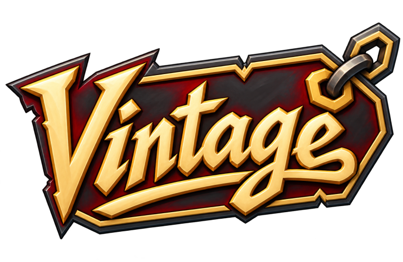

<p align="center">
  
</p>

<p align="center">
  <strong>The guild platform for Vintage on WoW: Forever</strong><br>
  An autonomous raid coordinator, the guild website, a swappable loot system, and an in-game
  addon, all on one typed command surface that people, Discord, and AI agents share.
</p>

<p align="center">
  <a href="https://github.com/vintage-guild/vintage/actions/workflows/ci.yml"></a>
  <a href="LICENSE.md"></a>
  <a href="https://github.com/orgs/vintage-guild/projects/1"></a>
</p>

---

## What it does

- **Coordinates raids on its own:** posts signups, reminds people, flags comp gaps, locks the
  roster, and hands the raid leader a one-click invite list.
- **Is the guild website:** recruitment and progress pages, member profiles, signups,
  wishlists, and loot history.
- **Uses Discord as identity:** sign in with Discord; Discord roles are the guild ranks.
- **Bridges into the game:** the `Vintage` addon forms the raid, records attendance and loot,
  and shows loot priority when items drop.
- **Is agent-native:** every capability is an [AFD](https://github.com/lushly-dev/afd) command,
  reachable over MCP and the CLI with the same permissions as the website.

## Status

**Phase 0 (foundation), due Nov 4.** Raids unlock **Dec 9**. Track progress on the
[project board](https://github.com/orgs/vintage-guild/projects/1) and the
[MVP epic](https://github.com/vintage-guild/vintage/issues/2).

Working today: the command layer (`guild-kit`); the `identity` module on Convex with guild
ranks, the role → rank map, and a role-sync cron; the Discord toolkit and interactions endpoint
(built, not deployed yet); design tokens with dark and parchment themes; the repo gates, CI, and
agent setup. Next: inviting the Vintage bot, Discord sign-in, a hosted Convex backend, `/mcp`,
and the website shell.

## Documentation

| Doc | For |
|---|---|
| [docs/architecture.md](docs/architecture.md) | How Vintage fits together: AFD, botcore, Convex modules, surfaces |
| [SETUP.md](SETUP.md) | First-time setup on your machine |
| [CONTRIBUTING.md](CONTRIBUTING.md) | How to contribute, and the [contributor agreement](CONTRIBUTOR_AGREEMENT.md) |
| [AGENTS.md](AGENTS.md) · [INIT.md](INIT.md) | Rules and orientation for AI agents |
| [PLAN.md](PLAN.md) | The full plan: architecture decisions, phases, open questions |
| [SUPPORT.md](SUPPORT.md) · [SECURITY.md](SECURITY.md) | Getting help · reporting vulnerabilities |

## Quick start

```bash
pnpm install
pnpm validate:final
```

Requires Node 24, pnpm 10, and `uv`. Details in [SETUP.md](SETUP.md).

## License

Code is licensed under the [PolyForm Noncommercial License 1.0.0](LICENSE.md): use, change, and
share it for any noncommercial purpose, keeping the license and its `Required Notice` line (that's
the attribution). Commercial use needs permission from the guild.

The Vintage logos and brand artwork in [`assets/brand/`](assets/brand/) are **all rights reserved**
([details](assets/brand/LICENSE.md)); forks must use their own branding.
