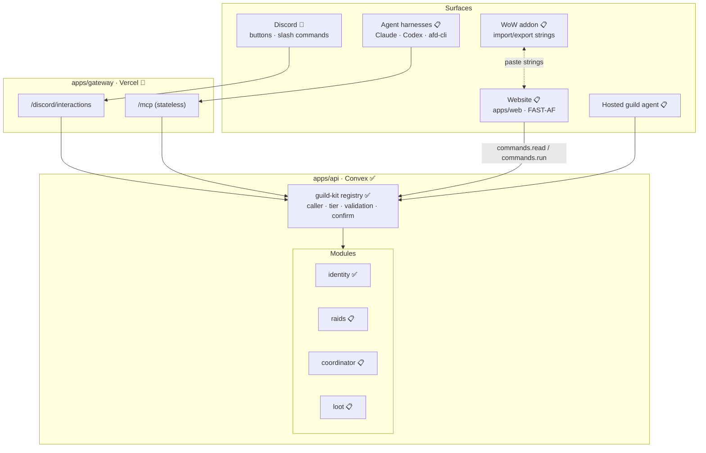
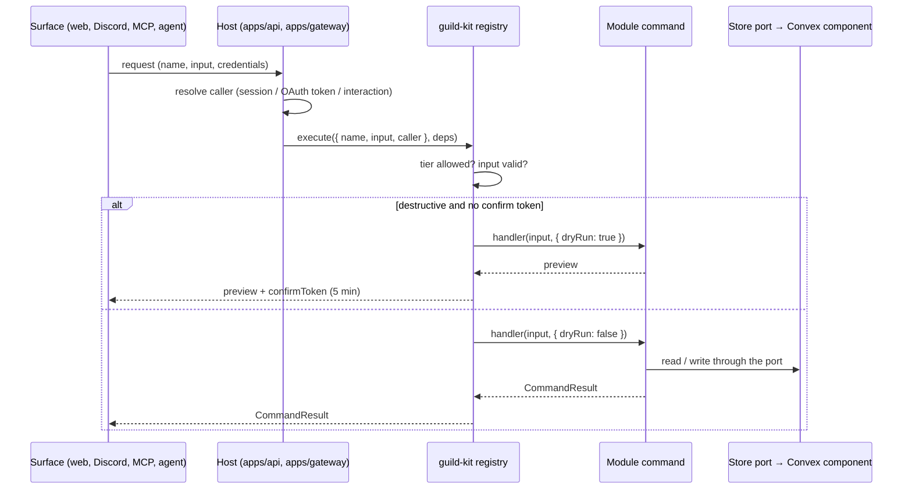

# Architecture

> Audience: contributors and their agents. Read this once to understand how Vintage fits
> together and which foundation projects it builds on. Durable rules live in
> [AGENTS.md](../AGENTS.md); the full plan and its reasoning live in [PLAN.md](../PLAN.md).

## Status legend

This document describes the target architecture. Each part is marked:

- ✅ **built**: exists on `main` and is tested
- 🚧 **in progress**: partly built or being built now
- 📋 **planned**: designed in PLAN.md, not started

## The idea in one paragraph

Every capability in Vintage is a **command**: a typed operation with a Zod input schema, a
minimum permission tier, and a structured result. Commands live in **modules** that own their
own data. One **registry** runs every command the same way no matter who asks: the website, a
Discord button, an agent over MCP, the CLI, or the hosted guild agent. Surfaces are thin; they
translate a request into a registry call and render the result. This is
**Agent-First Development (AFD)**: commands first, validated from the CLI/MCP, UI last.

## System overview



## Foundation projects

Vintage builds on a set of projects maintained by Bloodfen (Falkicon). They are dependencies,
not copies: when one has a bug or a gap, file it upstream (see [Upstream](#upstream-feedback)).

| Project | What it is | Where Vintage uses it | Status |
|---|---|---|---|
| [AFD](https://github.com/lushly-dev/afd) | Agent-First Development framework: command definitions, `CommandResult`, MCP server/client/CLI, testing helpers | `guild-kit` builds on `@lushly-dev/afd-core`; `/mcp` and `apps/cli` will use `afd-server` / `afd-cli` 2.2 (stateless Streamable HTTP, in progress upstream, not on npm yet) | ✅ core · 🚧 MCP |
| [botcore](https://github.com/lushly-dev/botcore) | Shared repo tooling for agents: commands, skills, plugins, one MCP server | `tooling/botcore` plugin + `vintagebot` CLI (`module-new`, `repo-check`); `botcore.toml` gates and skill seeding | ✅ |
| [FAST-AF](https://github.com/lushly-dev/fast-af) | FAST Element v3 runtime with AFD extensions: Definition Schema, `@command`, router, `violet-elements` primitives | Website components in `packages/ui-kit` and `apps/web` | 📋 |
| [Violet](https://github.com/lushly-dev/violet) | Design-token engine: inheritance tree of token nodes, build-time export | Not used yet: its CLI can't export from in-repo files in CI (spike Q14, upstream [lushly-dev/violet#30](https://github.com/lushly-dev/violet/issues/30)). `libs/design-tokens` keeps Violet's node model in plain DTCG so switching later only swaps the build script | 📋 |
| AFD site design system | Brand language (palette, type roles, motion, voice) for the AFD site | The `afd-site` base node in `libs/design-tokens`, reskinned by the `vintage` node | ✅ |
| [Mechanic](https://github.com/Falkicon/Mechanic) | WoW addon dev hub: diagnostics, library sync, sandbox tests, release commands | Addon library management (`libs.json`), offline Lua tests, packaging | 📋 |
| FenCore · FenUI · MechanicLib | WoW addon libraries: pure logic domains, themeable widgets with design tokens, Mechanic integration | The `Vintage` addon's core, UI, and diagnostics. `libs/design-tokens` already generates a theme table for `FenUI:RegisterTheme` | 📋 |

Outside that set, the main platforms are **Convex** (database, functions, crons), **Vercel**
(website and gateway hosting), **Better Auth** (Discord sign-in, MCP OAuth), **Discord**
(identity and the bot), and **WoW: Forever** (client 1.60.x, the Mainline API family).

## Core concepts

| Term | Meaning |
|---|---|
| **Command** | A named operation (`character-add`) with a Zod input, a minimum tier, and a handler returning `CommandResult`. Kebab-case `<noun>-<verb>`, per AFD. Defined with `commandsFor<Deps>()` from `guild-kit` |
| **Registry** | The single execution path in `guild-kit`: lookup → tier check → input validation → (dryRun → confirm token for destructive commands) → handler. Every surface uses it |
| **Guild rank** | Standing in the guild, from Discord roles: Officer, Raid Leader, Raider, Flex Raider, Recruit, Member, Friend. The coordinator uses it for priority |
| **Tier** | Permission level derived from rank: `public < member < recruit < raider < leader < officer`. Friends and unranked accounts are `public`. Written only by `member-sync` |
| **Caller** | Who is calling, resolved by the host before a command runs: surface, guild, tier, member id |
| **Module** | A workspace package under `modules/` that owns one feature area and its data |
| **Contract** | `src/contract.ts`: a module's public types, command names, and events. The only file other modules may import |
| **Store port** | An interface (e.g. `IdentityStore`) that commands depend on. `apps/api` adapts it to Convex; tests use an in-memory store |
| **Component** | A module's Convex component (`modules/<m>/convex`): its tables and internal functions, invisible to other modules |
| **Confirm token** | A short-lived HMAC token bound to a command, its exact input, and the caller. Destructive commands return a preview plus a token; the real call must present it |
| **Manifest** | `commands.manifest.json`: every command's name, tier, and schemas. CI diffs it; breaking changes need a label |
| **Event** | A cross-module notification (`raid-completed`) on the core event table, fanned out by the scheduler |

## How a command runs



Unknown commands and commands above the caller's tier get the same `COMMAND_NOT_FOUND`
answer, so surfaces never reveal what a caller can't run.

## Layers and boundaries

```
apps/      composition and transport (Convex app, Vercel gateway, website, CLI)
modules/   features with their own data (identity, raids, coordinator, loot, …)
packages/  platform glue (guild-kit, agent, ui-kit, testing, config)
libs/      pure, platform-free logic (wow-data, comp-solver, bridge-format, …)
```

Current packages:

| Package | Layer | What it is | Status |
|---|---|---|---|
| `libs/wow-data` | lib | Classes, specs, raid roles | ✅ |
| `libs/discord-kit` | lib | Interaction signature verification, response/embed/component builders, timestamps, rate-limit-aware REST client | ✅ |
| `libs/design-tokens` | lib | DTCG token nodes and exporters: CSS themes, TS map (`discordColor`), FenUI Lua theme | ✅ |
| `packages/guild-kit` | package | Commands, tiers, registry, confirm tokens, manifest | ✅ |
| `packages/testing` | package | Test callers, clock, registry helpers | ✅ |
| `modules/identity` | module | Members, characters, guild ranks, role → rank map, role sync planner | ✅ |
| `apps/api` | app | Convex: composes components, command surface, crons | ✅ |
| `apps/gateway` | app | Vercel functions: `/discord/interactions` (later `/mcp`) | 🚧 |

Dependencies only point down: `apps → modules → packages → libs`. Modules reach each other only
through `/contract`. Libs never import Convex, Discord, OpenAI, Vercel, or FAST-AF. These rules
are enforced by `pnpm check:boundaries`; the full table is in PLAN.md §4.1.

## Data

- **Each module owns its tables** in its own Convex component (`modules/<m>/convex/schema.ts`).
  `apps/api/convex/convex.config.ts` composes the components. ✅ (identity)
- **App-level tables** in `apps/api/convex/schema.ts`: `events` (the cross-module bus).
  ✅ schema · 📋 bus. The Discord role → rank map belongs to identity (`roleRanks`). ✅
- **Crons** in `apps/api/convex/crons.ts`: role sync every 15 minutes keeps ranks and tiers in
  step with Discord roles. ✅ (live Discord path unverified until the bot exists)
- **Every record carries `guildId`**, even though Vintage is single-guild today.
- **Codegen** (`convex/_generated`) is committed. Regenerate with
  `pnpm --filter @vintage/api dev:local`, which runs an anonymous local backend (no account).

## Surfaces

| Surface | How it works | Status |
|---|---|---|
| Website | FAST-AF components calling `commands.read` (live queries) and `commands.run` (mutations); themed by design tokens | 📋 |
| Discord | Serverless: interactions hit `/discord/interactions` in `apps/gateway` (Ed25519-verified, 3s deferred ack); posts, DMs, and member lists are REST calls through `libs/discord-kit`. The Vintage bot app exists; endpoint built and tested, not deployed yet | 🚧 |
| MCP | `/mcp` on AFD 2.2's stateless handler (MCP 2026-07-28 spec); AFD meta-tools (`afd-discover`, `afd-detail`, `afd-call`, `afd-batch`, `afd-pipe`); Better Auth OAuth | 📋 |
| CLI | `afd-cli --transport streamable` pointed at `/mcp` | 📋 |
| Hosted agent | OpenAI Agents SDK in Convex Node actions, using the same commands as the asking member | 📋 |
| WoW addon | `Vintage` on CurseForge (Weekly layout: pure `Core/`, WoW-facing `Bridge/`); exchanges versioned strings with the website | 📋 |

## Repo tooling and gates

| Gate | Command | Catches |
|---|---|---|
| Lint / format | `pnpm lint` | Biome rules, import order, complexity |
| Boundaries | `pnpm check:boundaries` | Upward deps, cross-module internals, escaping imports, cycles |
| Agent docs | `pnpm check:agent-docs` | AGENTS.md budget, broken links, missing skills or module docs |
| Manifest | `pnpm check:manifest` | Stale `commands.manifest.json` |
| Lockfile | part of `validate:final` | Stale `pnpm-lock.yaml` |
| Types and tests | `pnpm type-check`, `pnpm test:run` | TypeScript 6 (`tsc6`), Vitest |
| Gate self-tests | `pnpm check:scripts` | The CI selection, contract-break, DCO, and PR-title logic |

CI runs a `select` job that decides which lanes a change needs (TS, contract, addon, botcore,
workflow contracts), then a single required check, **`ci-ok`**, that fails if any owed lane
didn't pass. `select` also verifies PR commit sign-offs and the PR title. Locally,
`pnpm validate:final` runs the same gates; the pre-push hook runs it for you.

botcore's `vintagebot` exposes repo commands to people, CI, and agents:
`vintagebot module-new <name>` scaffolds a module that already passes every gate.

## Agent-native workflow

- **AGENTS.md** routes agents to commands, invariants, and skills; it stays short on purpose.
- **Skills** in `.claude/skills/` (shared with Codex): botcore-seeded generic skills plus
  `vintage-*` project skills, loaded on demand.
- **Reviewer agents** in `.claude/agents/`: read-only general, security, and addon reviewers.
- **Issues** follow the `agent-task` form (context, goal, non-goals, acceptance criteria);
  `fleet:candidate` marks work bounded enough for an agent.
- **Attribution:** the human driving a change authors and signs off its commits; AI help is
  disclosed with `Assisted-by:`, never `Co-authored-by:` (see AGENTS.md).
- **Model routing:** [operations/model-routing.md](operations/model-routing.md).

## Upstream feedback

When the bug or gap belongs to a foundation project, file it there, link it from a Vintage
issue labeled `upstream:<project>`, and keep any local workaround small and commented with the
link. Known items are tracked in PLAN.md §7.5.

## Where to go next

| You want to… | Read |
|---|---|
| Set up your machine | [SETUP.md](../SETUP.md) |
| Add or change a command | `.claude/skills/vintage-afd-commands` |
| Add a module or table | `.claude/skills/vintage-convex-modules` |
| Understand the why behind a decision | [PLAN.md](../PLAN.md) and `docs/features/` |
| Pick up work | The [Vintage MVP project](https://github.com/orgs/vintage-guild/projects/1) |
