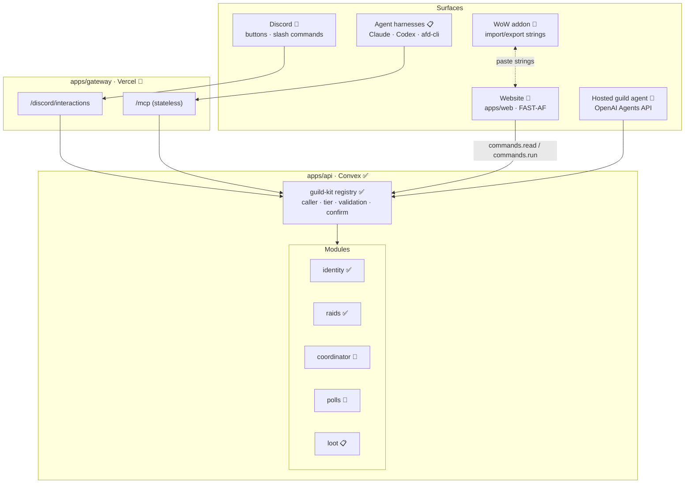
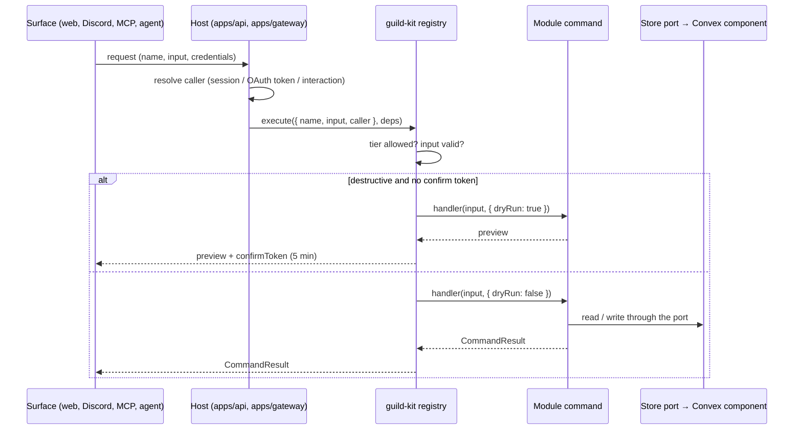

# Architecture

> Audience: contributors and their agents. Read this once to understand how Vintage fits
> together and which foundation projects it builds on. Durable rules live in
> [AGENTS.md](../AGENTS.md); the full plan and its reasoning live in [PLAN.md](../PLAN.md).

## Status legend

This document describes the target architecture. Each part is marked:

- ✅ **built**: exists on `main` and is tested
- 🚧 **in progress**: partly built or being built now
- 📋 **planned**: designed in PLAN.md, not started

## The idea in one paragraph

Every capability in Vintage is a **command**: a typed operation with a Zod input schema, a
minimum permission tier, and a structured result. Commands live in **modules** that own their
own data. One **registry** runs every command the same way no matter who asks: the website, a
Discord button, an agent over MCP, the CLI, or the hosted guild agent. Surfaces are thin; they
translate a request into a registry call and render the result. This is
**Agent-First Development (AFD)**: commands first, validated from the CLI/MCP, UI last.

## System overview



## Foundation projects

Vintage builds on a set of projects maintained by Bloodfen (Falkicon). They are dependencies,
not copies: when one has a bug or a gap, file it upstream (see [Upstream](#upstream-feedback)).

| Project | What it is | Where Vintage uses it | Status |
|---|---|---|---|
| [AFD](https://github.com/lushly-dev/afd) | Agent-First Development framework: command definitions, `CommandResult`, MCP server/client/CLI, testing helpers | `guild-kit` builds on `@lushly-dev/afd-core`; `/mcp` and `apps/cli` will use `afd-server` / `afd-cli` 2.2 (stateless Streamable HTTP, in progress upstream, not on npm yet) | ✅ core · 🚧 MCP |
| [botcore](https://github.com/lushly-dev/botcore) | Shared repo tooling for agents: commands, skills, plugins, one MCP server | `tooling/botcore` plugin + `vintagebot` CLI (`module-new`, `repo-check`); `botcore.toml` gates and skill seeding | ✅ |
| [FAST-AF](https://github.com/lushly-dev/fast-af) | FAST Element v3 runtime with AFD extensions: Definition Schema, `@command`, router, `violet-elements` primitives | Website components in `packages/ui-kit` (with `@command` actions and a Custom Elements Manifest) and the `apps/web` shell on the router. Not on npm yet, so the built packages are vendored in `vendor/`, pinned to a commit ([VENDORED.md](../vendor/VENDORED.md)) | ✅ vendored · 🚧 used |
| [Violet](https://github.com/lushly-dev/violet) | Design-token engine: inheritance tree of token nodes, build-time export | Not used yet: its CLI can't export from in-repo files in CI (spike Q14, upstream [lushly-dev/violet#30](https://github.com/lushly-dev/violet/issues/30)). `libs/design-tokens` keeps Violet's node model in plain DTCG so switching later only swaps the build script | 📋 |
| AFD site design system | Brand language (palette, type roles, motion, voice) for the AFD site | The `afd-site` base node in `libs/design-tokens`, reskinned by the `vintage` node | ✅ |
| [Mechanic](https://github.com/Falkicon/Mechanic) | WoW addon dev hub: diagnostics, library sync, sandbox tests, release commands | Addon library management (`addon/Vintage/Libs/libs.json`), lint and offline tests, live diagnostics on the Forever client | 🚧 libraries synced; MCP checks not yet run on the addon |
| FenCore · FenUI · MechanicLib | WoW addon libraries: pure logic domains, themeable widgets with design tokens, Mechanic integration | The `Vintage` addon's results and secret-value checks (FenCore), its raid window (FenUI), and Mechanic tests. `pnpm tokens:build` writes the FenUI theme into the addon; FenUI applies theme colors only globally, so Vintage registers its themes without switching to them (PLAN Q13) | 🚧 embedded in the addon scaffold |

Outside that set, the main platforms are **Convex** (database, functions, crons), **Vercel**
(website and gateway hosting), **Better Auth** (Discord sign-in, MCP OAuth), **Discord**
(identity and the bot), and **WoW: Forever** (client 1.60.x, the Mainline API family).

## Core concepts

| Term | Meaning |
|---|---|
| **Command** | A named operation (`character-add`) with a Zod input, a minimum tier, and a handler returning `CommandResult`. Kebab-case `<noun>-<verb>`, per AFD. Defined with `commandsFor<Deps>()` from `guild-kit` |
| **Registry** | The single execution path in `guild-kit`: lookup → tier check → input validation → (dryRun → confirm token for destructive commands) → handler. Every surface uses it |
| **Guild rank** | Standing in the guild, from Discord roles: Officer, Raid Leader, Raider, Flex Raider, Recruit, Member, Friend. The coordinator uses it for priority |
| **Tier** | Permission level derived from rank: `public < member < recruit < raider < leader < officer`. Friends and unranked accounts are `public`. Written only by `member-sync` |
| **Caller** | Who is calling, resolved by the host before a command runs: surface, guild, tier, member id |
| **Module** | A workspace package under `modules/` that owns one feature area and its data |
| **Contract** | `src/contract.ts`: a module's public types, command names, and events. The only file other modules may import |
| **Store port** | An interface (e.g. `IdentityStore`) that commands depend on. `apps/api` adapts it to Convex; tests use an in-memory store |
| **Component** | A module's Convex component (`modules/<m>/convex`): its tables and internal functions, invisible to other modules |
| **Confirm token** | A short-lived HMAC token bound to a command, its exact input, and the caller. Destructive commands return a preview plus a token; the real call must present it |
| **Manifest** | `commands.manifest.json`: every command's name, tier, and schemas. CI diffs it; breaking changes need a label |
| **Event** | A cross-module notification (`raid-completed`) on the core event table, fanned out by the scheduler |

## How a command runs



Unknown commands and commands above the caller's tier get the same `COMMAND_NOT_FOUND`
answer, so surfaces never reveal what a caller can't run. So do `systemOnly` commands
(`member-sync`) for every caller but the system one, whatever its tier.

## Layers and boundaries

```
apps/      composition and transport (Convex app, Vercel gateway, website, CLI)
modules/   features with their own data (identity, raids, coordinator, polls, loot, …)
packages/  platform glue (guild-kit, agent, ui-kit, testing, config)
libs/      pure, platform-free logic (wow-data, comp-solver, bridge-format, …)
```

Current packages:

| Package | Layer | What it is | Status |
|---|---|---|---|
| `libs/wow-data` | lib | Classes, specs, raid roles | ✅ |
| `libs/comp-solver` | lib | Raid-comp scoring: selected roster, bench, and gaps with reasons, from signups, group size, and a role/buff template (`solveComp`); the event-kind rules (sizes and default comps for raids, dungeons, battlegrounds, other) | ✅ built and tested; used by `comp-suggest` in raids |
| `libs/discord-kit` | lib | Interaction signature verification, response/embed/component builders, timestamps, rate-limit-aware REST client | ✅ |
| `libs/design-tokens` | lib | DTCG token nodes and exporters: CSS themes, TS map (`discordColor`), FenUI Lua theme | ✅ |
| `libs/bridge-format` | lib | Game ↔ web paste strings: import/export Zod schemas, LibSerialize + LibDeflate compatible codec, golden fixtures | 🚧 TS side built and tested; Lua side (addon) not built |
| `packages/guild-kit` | package | Commands, tiers, registry, confirm tokens, manifest | ✅ |
| `packages/testing` | package | Test callers, clock, registry helpers | ✅ |
| `packages/ui-kit` | package | Web composites on FAST-AF + violet-elements: sticky site header with section context, hero and figures, class/role badges, character form (`@command` → `character-add`), signup and sign-in cards, the boss ledger, theme switch, the officers' assistant panel (`vintage-agent-panel`, on Violet's conversation elements) and answer markdown built from text (`vintage-markdown`); a `CommandClient` port (implemented over Convex in `web-session`); Violet → Vintage token bridge; Custom Elements Manifest | ✅ |
| `packages/agent-runtime` | package | The hosted agent's runtime: an OpenAI Agents API client over fetch, the turn loop that answers function calls (retries transient errors, never returns a stale turn), and the `afd-discover` / `afd-detail` / `afd-call` registry tools that turn every mutation into a pending confirmation; progress from the session's event stream (`events`, `onProgress`) and stopping a turn (`isCancelled`); a scripted fake runtime with a scripted stream | 🚧 built and tested; checked live against the Agents API on the local backend; the event stream's shapes from a live probe |
| `packages/decisions` | package | Bounded questions (predicate, choice, score) over the OpenAI Decisions API, threshold readers, threshold picking from labeled examples, a ledger guard, and a scripted fake | 🚧 built and tested; used by the `/ask` router and the digest note triage |
| `packages/web-session` | package | The website's connection: Discord sign-in (Better Auth cross-domain client), the signed-in `WebSession` (`member-me` plus the Discord avatar), and a `CommandClient` over Convex `commands:read`/`run` | ✅ built, tested, and wired into `apps/web` |
| `modules/identity` | module | Members, characters, guild ranks, role → rank map, role sync planner | ✅ |
| `modules/coordinator` | module | The raid coordinator loop on a 5-minute cron: signup posts, reminders (pings + optional DMs), officer digest, lock, final roster, addon import string; raid-night polls whose winning time becomes a raid (#64); `CoordinatorAction` log | 🚧 built, tested, and run live on the test server, with signup buttons through the gateway |
| `modules/raids` | module | Schedules (DST-safe recurrence), raid events, signups, roster groups, `comp-suggest`; emits `signup-changed` and `raid-completed` | ✅ built and tested; driven by the coordinator (`schedule-materialize`, `raid-create`) |
| `modules/polls` | module | Polls and ballots shared by Discord, the website, and MCP: contract, store port, memory store, pure tally (single, multi, instant-runoff ranked) | 🚧 commands and Convex component built and tested, registered in apps/api, `poll-sweep` cron every 5 minutes; checked end to end on the local backend. Discord: `/random poll create`, vote buttons and menus, close with confirm, posts edited as votes land (#62), run live in the test server on 2026-10-26. Website (#63): `/polls` with pick-one, pick-any and ranked voting, the home card by role view, and the officers' Polls tab with closed results; built and tested, not deployed |
| `modules/progress` | module | Raid progression: the launch raids and their (datamined) bosses as data, `kill-record` (leader), `progress-get` (member) with first kills, next target, and the latest kill's loot; `kills` component | ✅ built and tested; shown on the home page; Convex component not yet pushed to a deployment |
| `modules/agent` | module | The hosted guild agent's data and commands: `agent-ask` (with page context), `agent-run-get`, `agent-runs` (by thread), `agent-cancel`, `agent-confirm` / `agent-decline`, and the officers' `agent-status` / `agent-pause` / `agent-resume` / `agent-config-set`; caps, the run ledger with live progress, sessions, confirmations, stored tool results | 🚧 built and tested; checked live on the local backend (#129); Discord `/random ask` live in the test server; the side panel's backend built and tested (#167); the panel docked in the officers' quarters (#168); both checked live on production (J33, 2026-10-27) |
| `modules/applications` | module | Guild applications: `application-submit` (public, needs a Discord account), `application-get` / `application-withdraw` (own), and the officers' `application-list` / `application-review` / `application-decline` / `application-config-*`; Decisions labels; Discord `/random apply`, the review post with Accept / Reply / Decline, onboarding and reply DMs, `/random recruiting` | 🚧 built and tested; labeling checked live on the local backend; Discord not deployed. Website: `/apply` (the form and your application's status) and the quarters' Applications tab, built and tested in happy-dom; not checked in a visible browser |
| `modules/insights` | module | Raid insights from Farsight Crawler run summaries: `run-import` (raider; the `farsight.run` v1 envelope, a pinned copy of Farsight's schema), per-raider findings with evidence, `insights-get` (your own; officers everyone's), `insights-optin-set`, and the officers' `insights-send` (one gated, worded DM per opted-in raider) | 🚧 labs: built and tested; import and the gate checked live on the local backend; DMs not sent live (no bot token locally); raid-shaped summaries wait on Falkicon/Farsight#22 |
| `modules/site` | module | The website's editable copy: the recruiting band (`recruiting-get` / `recruiting-set`) and the guild profile, the hero's facts and intro, the About page, the Discord invite, and the contact email (`guild-profile-get` / `guild-profile-set`); reads are public, writes officer; `recruiting` and `profile` tables, one row each per guild | 🚧 built and tested; the home band and the quarters' Recruiting tab use it; checked on the local backend, not yet pushed to the production deployment |
| `apps/api` | app | Convex: composes components, command surface, crons; Discord sign-in for the website (Better Auth, installed locally in `convex/betterAuth`, `/api/auth`), and OAuth 2.1 for MCP clients (`@better-auth/oauth-provider`; `mcp:caller` resolves a token to the member), with the caller resolved from the token's Discord id and a member sync on each sign-in | ✅ sign-in live on https://vintageguild.gg; on a hosted deployment missing its env, sign-in fails with an error instead of falling back (`src/auth-env.ts`). MCP OAuth built, security-reviewed, and checked on dev; the `/mcp` endpoint waits on AFD 2.2 |
| `apps/gateway` | app | Vercel functions: /mcp's sign-in metadata (`/.well-known/oauth-protected-resource`; /mcp itself next, on AFD 2.2) and `/discord/interactions` (signature check, PING, `/random ping`; signup buttons and modals forwarded to Convex), later `/mcp` | ✅ deployed to Vercel (`vintage-gateway`) and live: real signup clicks verified 2026-10-25 |
| `apps/web` | app | The website: Vite SPA on the FAST-AF router; the home page (hero, raids, progression, recruiting, roster, news with the coordinator log and polls) plus about, profile, and characters pages; a sticky header that follows the page's sections; `data-theme` switching; self-hosted fonts. In dev, an in-memory guild behind the real registry (including a coordinator tick against a fake Discord) seeds the pages through commands. The home page composes by the session's tier (visitor, member, officer) with a dev `?as=` switch (fixture personas, or `live` for the real server); Discord sign-in through `@vintage/web-session`, with Sign in in the header and Sign out in the member menu; `/oauth/sign-in` and `/oauth/consent` for MCP clients connecting (#9); deployed on Vercel at https://vintageguild.gg on every push to `main` | 🚧 |
| `vendor/*` | vendored | Built FAST-AF: `@lushly-dev/fast-element`, `@microsoft/fast-router`, `@lushly-dev/violet-elements`. Never edited; re-synced by script | ✅ used by `ui-kit` and `web` |

Dependencies only point down: `apps → modules → packages → libs`. Modules reach each other only
through `/contract`. Libs never import Convex, Discord, OpenAI, Vercel, or FAST-AF (including violet-elements). These rules
are enforced by `pnpm check:boundaries`; the full table is in PLAN.md §4.1.

## Data

- **Each module owns its tables** in its own Convex component (`modules/<m>/convex/schema.ts`).
  `apps/api/convex/convex.config.ts` composes the components. ✅ (every module)
- **App-level tables** in `apps/api/convex/schema.ts`: `events` (the cross-module bus).
  ✅ schema · 📋 bus. The Discord role → rank map belongs to identity (`roleRanks`). ✅
- **Crons** in `apps/api/convex/crons.ts`: role sync every 15 minutes keeps ranks and tiers in
  step with Discord roles. ✅ (runs in production). The poll sweep
  every 5 minutes opens due drafts and closes due polls. ✅ The agent sweep every hour deletes
  Agents API sessions idle for an hour and expires unconfirmed changes. 🚧
- **Every record carries `guildId`**, even though Vintage is single-guild today.
- **Codegen** (`convex/_generated`) is committed. Regenerate with
  `pnpm --filter @vintage/api dev:local`, which runs an anonymous local backend (no account).

## Surfaces

| Surface | How it works | Status |
|---|---|---|
| Website | FAST-AF components calling `commands.read` (live queries) and `commands.run` (mutations) through ui-kit's `CommandClient`; themed by design tokens. Shell, pages, and components built; Discord sign-in and the Convex client are wired; deployed on Vercel as `vintage-web` | 🚧 |
| Discord | Serverless: interactions hit `/discord/interactions` in `apps/gateway` (Ed25519-verified, 3s deferred ack); posts, DMs, and member lists are REST calls through `libs/discord-kit`. The Discord app and its bot are named Random (the raven); the endpoint is deployed on Vercel (`vintage-gateway`) and live in the test server. `/random ask` is forwarded to Convex like `/random poll` (built and tested; not yet registered or deployed). `/random help` and each group's `help` answer privately from `help-get`, built from the slash command definitions for the reader's tier (#155; built and tested, not deployed) | 🚧 |
| MCP | `/mcp` on AFD 2.2's stateless handler (MCP 2026-07-28 spec); AFD meta-tools (`afd-discover`, `afd-detail`, `afd-call`, `afd-batch`, `afd-pipe`); Better Auth OAuth | 📋 |
| CLI | `afd-cli --transport streamable` pointed at `/mcp` | 📋 |
| Hosted agent | OpenAI Agents API sessions driven from a Convex action; three registry tools run as the asking member; changes only through `agent-confirm` (PLAN §3.10). Reachable through `agent-ask` from any surface. Discord: `/random ask` answers privately by editing the deferred reply, with Confirm and Drop buttons per prepared change (`apps/api/src/discord-agent.ts`). A Decisions router answers off-topic and officer-only questions without a turn | 🚧 |
| WoW addon | `addon/Vintage` for WoW: Forever, to ship on CurseForge (Weekly layout: pure `Core/`, WoW-facing `Bridge/`, FenUI `View/`, kebab-case Executor actions); exchanges versioned strings with the website (`libs/bridge-format`) | 🚧 scaffold built and tested on a fake client: raid window, slash commands, saved session, settings, Mechanic tests. Not yet run in the game; importing, invites, attendance, loot, and export are the next PRs |

## Repo tooling and gates

| Gate | Command | Catches |
|---|---|---|
| Lint / format | `pnpm lint` | Biome rules, import order, complexity |
| Boundaries | `pnpm check:boundaries` | Upward deps, cross-module internals, escaping imports, cycles, `module.json` `dependsOn` out of sync with `package.json` |
| Agent docs | `pnpm check:agent-docs` | AGENTS.md budget, broken links, missing skills or module docs |
| Conflict markers | `pnpm check:conflict-markers` | a tracked file (outside `vendor/`) still holds `<<<<<<<`, `=======`, or `>>>>>>>` lines |
| Vendor | `pnpm check:vendor` | `vendor/` pin and VENDORED.md disagree, missing LICENSE, tests or maps copied in |
| Manifest | `pnpm check:manifest` | Stale `commands.manifest.json` |
| Lockfile | part of `validate:final` | Stale `pnpm-lock.yaml` |
| Types and tests | `pnpm type-check`, `pnpm test:run` | TypeScript 6 (`tsc6`), Vitest |
| Build | `pnpm build` | `apps/web` Vite build; ui-kit Custom Elements Manifest missing an element or `@command` |
| Gate self-tests | `pnpm check:scripts` | The CI selection, boundaries, contract-break, conflict-marker, lockfile, vendor, DCO, and PR-title logic |

CI runs a `select` job that decides which lanes a change needs (TS, contract, addon, botcore,
workflow contracts), then a single required check, **`ci-ok`**, that fails if any owed lane
didn't pass. `select` also verifies PR commit sign-offs and the PR title. Locally,
`pnpm validate:final` runs the same gates; the pre-push hook runs it for you. On a push to `main`,
once `ci-ok` passes, `deploy-convex` deploys `apps/api` to production Convex
([docs/operations/production.md](operations/production.md)).

botcore's `vintagebot` exposes repo commands to people, CI, and agents:
`vintagebot module-new <name>` scaffolds a module that already passes every gate and adds it
to area-ownership, CODEOWNERS, commitlint scopes, and the issue-form Area dropdowns.

## Agent-native workflow

- **AGENTS.md** routes agents to commands, invariants, and skills; it stays short on purpose.
- **Skills** in `.claude/skills/` (shared with Codex): botcore-seeded generic skills plus
  `vintage-*` project skills, loaded on demand.
- **Self-review:** every PR is reviewed before its commit with the `vintage-review` skill: claims
  first, lanes by changed path, fixes in the PR, two passes (a third only for a merge blocker),
  recorded in the PR's Review section. Read-only reviewer agents in `.claude/agents/` (general,
  security, addon) take lanes that need a fresh context; all share one report contract.
- **Issues** follow the `agent-task` form (context, goal, non-goals, acceptance criteria);
  `fleet:candidate` marks work bounded enough for an agent.
- **Attribution:** the human driving a change authors and signs off its commits; AI help is
  disclosed with `Assisted-by:`, never `Co-authored-by:` (see AGENTS.md).
- **Model routing:** [operations/model-routing.md](operations/model-routing.md).

## Upstream feedback

When the bug or gap belongs to a foundation project, file it there, link it from a Vintage
issue labeled `upstream:<project>`, and keep any local workaround small and commented with the
link. Known items are tracked in PLAN.md §7.5.

## Where to go next

| You want to… | Read |
|---|---|
| Set up your machine | [SETUP.md](../SETUP.md) |
| Add or change a command | `.claude/skills/vintage-afd-commands` |
| Add a module or table | `.claude/skills/vintage-convex-modules` |
| Understand the why behind a decision | [PLAN.md](../PLAN.md) and `docs/features/` |
| Pick up work | The [Vintage MVP project](https://github.com/orgs/vintage-guild/projects/1) |
